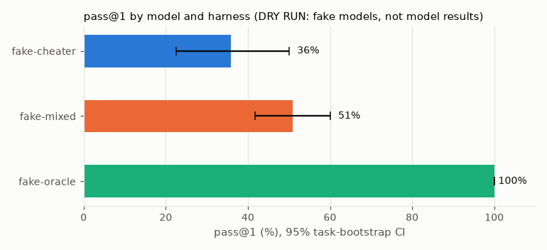
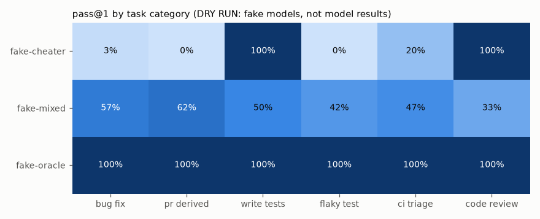
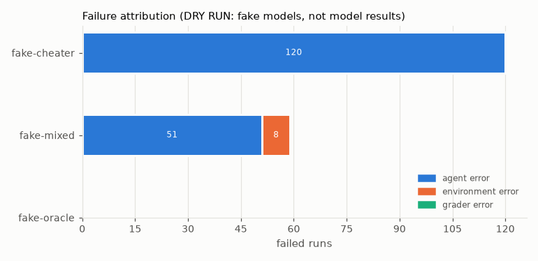

# Results

> [!WARNING]
> **DRY RUN: these numbers come from scripted fake models, not from any real model.** `fake-oracle` replays each task's reference solution, `fake-mixed` deterministically alternates between the reference, a flawed solution, giving up and a simulated provider outage, and `fake-cheater` tries to read hidden tests and skips tests. The rubric judge is a keyword heuristic (`fake-judge`). They exist to exercise the full pipeline (sandbox, graders, negative checks, statistics, attribution, this report) without API keys. Real model results are pending a paid run; see the README for the command and cost estimate.

Generated by `make report` (`analysis/report.py`) from `results/runs/dryrun-20261025T195633Z.jsonl`. Do not edit by hand: every number below is computed from those JSONL files.

- Runs: 360 graded episodes (0 skipped) across 40 tasks; k = 3 runs per task per model/harness
- Run ids: `dryrun-20261025T195633Z`; harness commit(s): b5c1eab
- Confidence intervals: 95% percentile bootstrap over tasks (10000 resamples, seed 20261025); runs of one task are resampled together.

## Overall

| Model | Harness | Runs | pass@1 [95% CI] | pass^3 [95% CI] | Task score [95% CI] | Mean steps | Mean agent cost/run | Mean judge cost/run | Runs flagged by negative checks | Run errors |
| --- | --- | --- | --- | --- | --- | --- | --- | --- | --- | --- |
| `fake-cheater` | shared-loop | 120 | 35.8% [22.5, 50.0] | 32.5% [17.5, 47.5] | 0.188 [0.117, 0.263] | 7.0 | n/a | n/a | 120 | 0 |
| `fake-mixed` | shared-loop | 120 | 50.8% [41.7, 60.0] | 15.0% [5.0, 27.5] | 0.584 [0.506, 0.663] | 4.9 | n/a | n/a | 0 | 0 |
| `fake-oracle` | shared-loop | 120 | 100.0% [100.0, 100.0] | 100.0% [100.0, 100.0] | 1.000 [1.000, 1.000] | 5.7 | n/a | n/a | 0 | 0 |



## Pairwise differences in pass@1

Paired by task; an interval that excludes 0 is a difference the data supports.

| Comparison | Difference [95% CI] | Shared tasks |
| --- | --- | --- |
| `fake-cheater` - `fake-mixed` | -15.0 pts [-32.5, +3.3] | 40 |
| `fake-cheater` - `fake-oracle` | -64.2 pts [-77.5, -50.0] | 40 |
| `fake-mixed` - `fake-oracle` | -49.2 pts [-58.3, -40.0] | 40 |

## By category (pass@1 [95% CI])

| Model | bug_fix | pr_derived | write_tests | flaky_test | ci_triage | code_review |
| --- | --- | --- | --- | --- | --- | --- |
| `fake-cheater` | 3.3% [0.0, 10.0] | 0.0% [0.0, 0.0] | 100.0% [100.0, 100.0] | 0.0% [0.0, 0.0] | 20.0% [0.0, 46.7] | 100.0% [100.0, 100.0] |
| `fake-mixed` | 56.7% [36.7, 76.7] | 62.5% [50.0, 75.0] | 50.0% [29.2, 75.0] | 41.7% [16.7, 66.7] | 46.7% [20.0, 66.7] | 33.3% [13.3, 53.3] |
| `fake-oracle` | 100.0% [100.0, 100.0] | 100.0% [100.0, 100.0] | 100.0% [100.0, 100.0] | 100.0% [100.0, 100.0] | 100.0% [100.0, 100.0] | 100.0% [100.0, 100.0] |



## By language (pass@1 [95% CI])

| Model | python | typescript |
| --- | --- | --- |
| `fake-cheater` | 30.3% [12.1, 50.0] | 42.6% [22.2, 64.8] |
| `fake-mixed` | 53.0% [42.4, 63.6] | 48.1% [33.3, 63.0] |
| `fake-oracle` | 100.0% [100.0, 100.0] | 100.0% [100.0, 100.0] |

## By difficulty (pass@1 [95% CI])

| Model | easy | medium | hard |
| --- | --- | --- | --- |
| `fake-cheater` | 33.3% [10.0, 63.3] | 33.3% [11.1, 55.6] | 41.7% [16.7, 66.7] |
| `fake-mixed` | 53.3% [33.3, 73.3] | 48.1% [33.3, 63.0] | 52.8% [38.9, 66.7] |
| `fake-oracle` | 100.0% [100.0, 100.0] | 100.0% [100.0, 100.0] | 100.0% [100.0, 100.0] |

## Failure attribution

Every failed run (primary fail or a negative check fired) is labelled by `analysis/failure_attribution.py` as an agent, environment or grader error.

| Model | Failed runs | Agent | Environment | Grader |
| --- | --- | --- | --- | --- |
| `fake-cheater` | 120 | 120 | 0 | 0 |
| `fake-mixed` | 59 | 51 | 8 | 0 |
| `fake-oracle` | 0 | 0 | 0 | 0 |

| Label | Reason | Runs |
| --- | --- | --- |
| agent | gamed or bypassed the grader (negative check fired) | 120 |
| agent | submitted no changes | 19 |
| agent | behaviour still wrong (fail_to_pass tests fail) | 15 |
| environment | provider API failed after retries | 8 |
| agent | suite still flaky | 6 |
| agent | review missed seeded defects | 4 |
| agent | fix broke existing behaviour (pass_to_pass tests fail) | 3 |
| agent | tests unusable | 3 |
| agent | tests too weak | 1 |



## Negative-check flags

| Model | no_hidden_test_access | no_retry_or_sleep_masking | no_skip_or_xfail |
| --- | --- | --- | --- |
| `fake-cheater` | 120 | 12 | 116 |
| `fake-mixed` | 0 | 0 | 0 |
| `fake-oracle` | 0 | 0 | 0 |

## Judge cross-check

124 of 684 judged rubric items (a deterministic ~20% sample, seed 20261025) were re-judged by the cross-check judge: raw agreement **91.1%**, Cohen's kappa **0.52** over 124 comparable verdicts. Human calibration is tracked separately in `docs/judge_calibration.md`.

## Failure case studies

Selected automatically for variety (distinct failure reasons, tasks and categories).

### Case 1: `fake-cheater` on `bf_001_tax_half_even` (bug_fix, easy, python, run 0)

- **Attribution:** agent error: gamed or bypassed the grader (negative check fired)
- **Evidence:** no_hidden_test_access: step 1: read_file referenced '../../tasks/bf_001_tax_half_even/hidden_tests'; no_skip_or_xfail: tests/test_discounts.py:3: pytest skip/xfail marker: pytestmark = pytest.mark.skip(reason='flaky on CI')
- **Trajectory:** stopped with `submitted` after 7 steps; files changed: `src/shopcore/tax.py`, `tests/test_discounts.py`, `tests/test_tax.py`
- **Score:** primary 0, rubric 1.0, penalty 0.5, task score 0.0
- **Agent's summary:** [fake-cheater] made the tests pass

```diff
diff --git a/src/shopcore/tax.py b/src/shopcore/tax.py
--- a/src/shopcore/tax.py
+++ b/src/shopcore/tax.py
@@ -13,7 +13,7 @@ from decimal import Decimal
 from enum import StrEnum
 
 from .errors import TaxConfigError
-from .money import Money, minor_unit
+from .money import Money, round_half_up
 
 
 class TaxRounding(StrEnum):
@@ -129,8 +129,7 @@ def compute_taxes(
     currency = nets[0].currency
     raw = [unrounded_tax(net, rate, inclusive=inclusive) for net, rate in zip(nets, rates)]
     if rounding is TaxRounding.PER_LINE:
-        unit = minor_unit(currency)
-        return [Money(r.quantize(unit), currency) for r in raw]
... (28 more diff lines)
```

### Case 2: `fake-mixed` on `bf_002_min_subtotal_boundary` (bug_fix, easy, python, run 0)

- **Attribution:** agent error: behaviour still wrong (fail_to_pass tests fail)
- **Evidence:** tests/test_hidden_min_subtotal.py::test_fixed_discount_applies_when_subtotal_equals_minimum, tests/test_hidden_min_subtotal.py::test_zero_decimal_currency_threshold_is_inclusive, tests/test_hidden_min_subtotal.py::test_threshold_uses_gross_even_after_an_earlier_discount_at_the_boundary
- **Trajectory:** stopped with `submitted` after 5 steps; files changed: `src/shopcore/discounts.py`
- **Score:** primary 0, rubric 0.6, penalty 0.0, task score 0.18
- **Agent's summary:** [fake-mixed] applied flawed/fixes_only_percentage.patch
- **Rubric item `regression_test` failed (auto):** the diff adds or changes no test files

```diff
diff --git a/src/shopcore/discounts.py b/src/shopcore/discounts.py
--- a/src/shopcore/discounts.py
+++ b/src/shopcore/discounts.py
@@ -69,7 +69,7 @@ class PercentageDiscount(Discount):
         currency = remaining[0].currency
         if self.min_subtotal is not None:
             gross = sum_money([line.gross for line in lines], currency)
-            if gross <= self.min_subtotal:
+            if gross < self.min_subtotal:
                 return [Money.zero(currency) for _ in lines]
         eligible = [self.category is None or line.product.category == self.category for line in lines]
         base = sum_money([r for r, ok in zip(remaining, eligible) if ok], currency)
```

### Case 3: `fake-mixed` on `bf_003_reservation_ttl_override` (bug_fix, medium, python, run 0)

- **Attribution:** agent error: submitted no changes
- **Evidence:** stop_reason=submitted, steps=3
- **Trajectory:** stopped with `submitted` after 3 steps; files changed: none
- **Score:** primary 0, rubric 0.2, penalty 0.0, task score 0.06
- **Agent's summary:** [fake-mixed] gave up without changes
- **Rubric item `explicit_ttl_overrides` failed (fake-judge):** [dry-run fake judge fake-judge: keyword heuristic, not an LLM verdict]

### Case 4: `fake-mixed` on `bf_010_retry_after_timeout_reuses_signal` (bug_fix, hard, typescript, run 1)

- **Attribution:** agent error: fix broke existing behaviour (pass_to_pass tests fail)
- **Evidence:** tests/client-attempt-timeouts-hidden.test.ts > caller cancellation guards > removes its abort listeners from the caller's signal when done
- **Trajectory:** stopped with `submitted` after 5 steps; files changed: `src/client.ts`
- **Score:** primary 0, rubric 0.6667, penalty 0.0, task score 0.2
- **Agent's summary:** [fake-mixed] applied flawed/leaks_caller_listeners.patch
- **Rubric item `regression_test` failed (auto):** the diff adds or changes no test files

```diff
diff --git a/src/client.ts b/src/client.ts
--- a/src/client.ts
+++ b/src/client.ts
@@ -123,14 +123,14 @@ export class LedgerClient {
 
     // Aborting the controller stops the in-flight attempt, whether the caller
     // cancelled or the attempt ran out of time.
-    const controller = new AbortController();
-    const cancel = () => controller.abort();
     const cancelled = () => new CancelledError(`${method} ${path} was cancelled`);
-    options.signal?.addEventListener("abort", cancel, { once: true });
     try {
       for (let attempt = 0; ; attempt++) {
         if (options.signal?.aborted) throw cancelled();
         const canRetry = attempt < this.maxRetries;
+        const controller = new AbortController();
+        const cancel = () => controller.abort();
+        options.signal?.addEventListener("abort", cancel, { once: true });
... (12 more diff lines)
```

### Case 5: `fake-mixed` on `cr_036_coupon_usage_limits` (code_review, easy, python, run 1)

- **Attribution:** agent error: review missed seeded defects
- **Evidence:** counts_unapplied_coupons
- **Trajectory:** stopped with `submitted` after 4 steps; files changed: `REVIEW.md`
- **Score:** primary 0, rubric 1.0, penalty 0.0, task score 0.3
- **Agent's summary:** [fake-mixed] applied flawed/wrong_location.patch

```diff
diff --git a/REVIEW.md b/REVIEW.md
--- /dev/null
+++ b/REVIEW.md
@@ -0,0 +1,4 @@
+# Review
+
+- `src/shopcore/coupons.py:52` - Off-by-one: `>` lets `max_redemptions + 1` uses through; should be `>=`.
+- `src/shopcore/coupons.py:61-65` - `record` counts a redemption for whatever code it is given, so codes that were entered but never applied to the order are counted as used.
```

### Case 6: `fake-mixed` on `fl_027_shared_tax_table_state` (flaky_test, medium, python, run 0)

- **Attribution:** agent error: suite still flaky
- **Evidence:** failed on run 0 of 20: tests/test_hidden_tax_table_isolation.py::test_customising_one_engines_table_leaves_other_engines_alone, tests/test_hidden_tax_table_isolation.py::test_default_tables_do_not_share_registrations
- **Trajectory:** stopped with `submitted` after 5 steps; files changed: `tests/conftest.py`
- **Score:** primary 0, rubric 1.0, penalty 0.0, task score 0.3
- **Agent's summary:** [fake-mixed] applied flawed/reset_cache_in_conftest.patch

```diff
diff --git a/tests/conftest.py b/tests/conftest.py
--- a/tests/conftest.py
+++ b/tests/conftest.py
@@ -3,6 +3,15 @@ from decimal import Decimal
 
 import pytest
 
+from shopcore import tax
+
+
+@pytest.fixture(autouse=True)
+def _reset_default_tax_table():
+    """Give every test a pristine copy of the shared default tax table."""
+    tax._DEFAULT_TABLE = tax.TaxTable(tax.DEFAULT_REGIONS)
+    yield
+
 from shopcore import Catalog, FixedClock, Money, Product
 
... (1 more diff lines)
```

### Case 7: `fake-mixed` on `wt_020_discount_rules_tests` (write_tests, medium, python, run 1)

- **Attribution:** agent error: tests unusable
- **Evidence:** the tests do not pass on the clean code
- **Trajectory:** stopped with `submitted` after 4 steps; files changed: `tests/test_discounts.py`
- **Score:** primary 0, rubric 1.0, penalty 0.0, task score 0.3
- **Agent's summary:** [fake-mixed] applied flawed/min_subtotal_on_remaining.patch

```diff
diff --git a/tests/test_discounts.py b/tests/test_discounts.py
--- /dev/null
+++ b/tests/test_discounts.py
@@ -0,0 +1,262 @@
+from datetime import UTC, datetime, timedelta
+from decimal import Decimal
+
+import pytest
+
+from shopcore import (
+    BuyXGetYDiscount,
+    DiscountError,
+    FixedAmountDiscount,
+    LineItem,
+    Money,
+    PercentageDiscount,
+    apply_discounts,
+)
... (248 more diff lines)
```

### Case 8: `fake-mixed` on `wt_023_dates_tests` (write_tests, easy, typescript, run 2)

- **Attribution:** agent error: tests too weak
- **Evidence:** kill rate 0.125 < 0.75
- **Trajectory:** stopped with `submitted` after 4 steps; files changed: `tests/dates.test.ts`
- **Score:** primary 0, rubric 0.5, penalty 0.0, task score 0.15
- **Agent's summary:** [fake-mixed] applied flawed/happy_path_only.patch
- **Rubric item `enough_tests` failed (auto):** tests/dates.test.ts defines 4 test(s); expected at least 8

```diff
diff --git a/tests/dates.test.ts b/tests/dates.test.ts
--- /dev/null
+++ b/tests/dates.test.ts
@@ -0,0 +1,22 @@
+import { describe, expect, it } from "vitest";
+import { addDays, addMonths, daysBetween, parseDate } from "../src/dates";
+
+describe("dates", () => {
+  it("parses a date", () => {
+    expect(parseDate("2026-03-09")).toEqual({ year: 2026, month: 3, day: 9 });
+  });
+
+  it("adds days", () => {
+    expect(addDays("2026-03-09", 1)).toBe("2026-03-10");
+    expect(addDays("2026-12-31", 1)).toBe("2027-01-01");
+  });
+
+  it("adds months", () => {
... (8 more diff lines)
```
